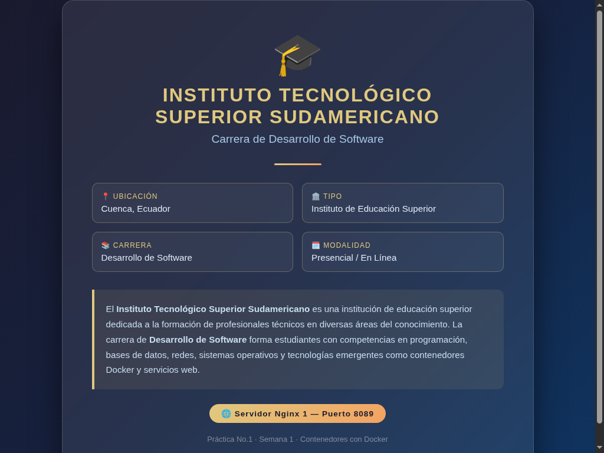
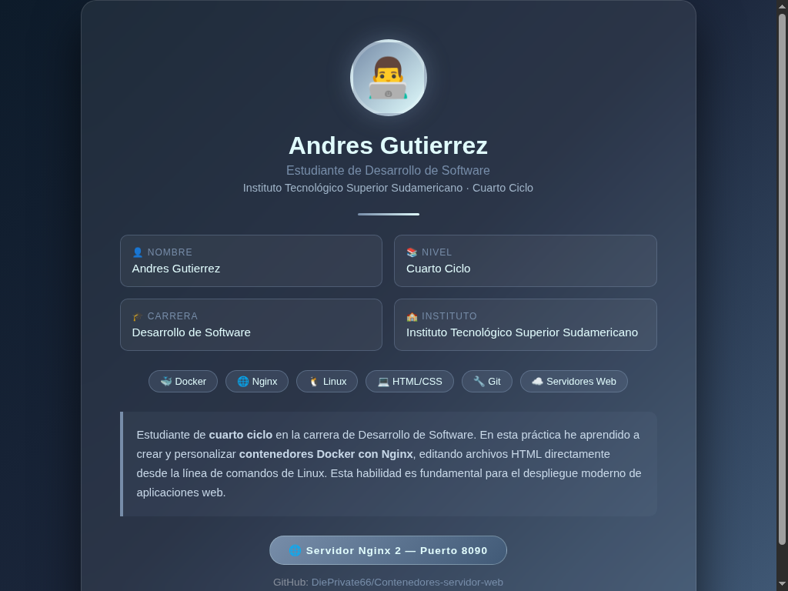

# Contenedores Servidor Web con Nginx y Docker

[](informe.md)
[](https://www.docker.com/)
[](https://nginx.org/)
[](https://sudamericano.edu.ec/)
[](https://github.com/DiePrivate66)

Repositorio oficial de la **Práctica No. 1 — Tarea autónoma semana 1: Crear y personalizar dos servidores web con Nginx usando Docker**.

* **Estudiante:** Andrés Gutiérrez
* **Carrera:** Desarrollo de Software
* **Ciclo:** Cuarto Ciclo
* **Institución:** Instituto Tecnológico Superior Sudamericano
* **Asignatura:** Tendencias de Tecnología
* **Repositorio:** [https://github.com/DiePrivate66/Contenedores-servidor-web](https://github.com/DiePrivate66/Contenedores-servidor-web)

---

## 📑 Informe Técnico Completo

El informe detallado de la práctica, elaborado siguiendo estrictamente la estructura de 10 puntos de la plantilla [maguaman2/informe-tendencias](https://github.com/maguaman2/informe-tendencias), se encuentra disponible en:

👉 **[Ver Informe Completo (informe.md)](informe.md)**

---

## 📂 Estructura del Repositorio

```text
Contenedores-servidor-web/
├── informe.md                       # Informe técnico formal de la práctica (10 puntos)
├── README.md                        # Presentación y guía rápida de reproducción
├── index1.html                      # Página institucional personalizada (nginx1)
├── index2.html                      # Página personal del estudiante (nginx2)
├── audio_aprendizaje_semana1.mp3    # (Opcional en repo) Audio de 60s grabado con voz propia
└── img/                             # Evidencias y diagramas
    ├── docker_architecture.png      # Diagrama de arquitectura de contenedores
    ├── nginx1_cuenca_screenshot.png # Captura de pantalla del servidor institucional (8089)
    └── nginx2_screenshot.png        # Captura de pantalla del servidor personal (8090)
```

---

## 🚀 Guía Rápida para Reproducir la Práctica

### 1. Iniciar los contenedores Nginx
```bash
docker run -d --name nginx1 -p 8089:80 nginx
docker run -d --name nginx2 -p 8090:80 nginx
```

### 2. Copiar los archivos HTML personalizados
```bash
docker cp index1.html nginx1:/usr/share/nginx/html/index.html
docker cp index2.html nginx2:/usr/share/nginx/html/index.html
```

### 3. Verificar el estado
```bash
docker ps
```

---

## 🌐 Servidores Desplegados

| Servidor | Puerto Host | Puerto Contenedor | Contenido | URL Local |
|---|---|---|---|---|
| **nginx1** | `8089` | `80` | Información institucional ITSS Sudamericano | [http://localhost:8089](http://localhost:8089) |
| **nginx2** | `8090` | `80` | Información personal de Andrés Gutiérrez | [http://localhost:8090](http://localhost:8090) |

---

## 🎙️ Audio de Aprendizaje (60 Segundos)

El estudiante grabará este archivo con su propia voz para adjuntarlo a la entrega en la plataforma académica, según las instrucciones de la práctica.

* **Guion de grabación:** Disponible en [informe.md](informe.md#guion-y-transcripción-de-la-grabación-lectura-estimada-60-segundos)
* **Duración requerida:** ~60 segundos
* **Formato sugerido:** Archivo `.mp3` para adjuntar en la entrega académica.

---

## 🖼️ Capturas de Resultados

### Servidor 1 (Institucional - Puerto 8089)


### Servidor 2 (Personal - Puerto 8090)

