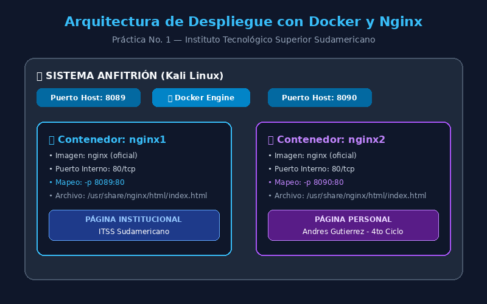

# Práctica servidor web

**Instituto Tecnológico Superior Sudamericano**  
**Carrera:** Desarrollo de Software  
**Ciclo:** Cuarto Ciclo  
**Asignatura:** Tendencias de Tecnología  
**Estudiante:** Andrés Gutiérrez  
**Repositorio de GitHub:** [https://github.com/DiePrivate66/Contenedores-servidor-web](https://github.com/DiePrivate66/Contenedores-servidor-web)  
**Fecha:** Octubre 2026  

---

## 1. Titulo

**Práctica No. 1 — Creación y Personalización de Dos Servidores Web con Nginx usando Docker en Linux**

---

## 2. Tiempo de duración

**Tiempo total estimado y ejecutado:** 60 minutos

| Fase / Actividad | Tiempo | Descripción |
|---|---|---|
| 1. Preparación del entorno | 10 min | Verificación de Docker Engine en Kali Linux y descarga de la imagen oficial de Nginx |
| 2. Despliegue de contenedores | 10 min | Creación y ejecución de los contenedores `nginx1` (puerto 8089) y `nginx2` (puerto 8090) |
| 3. Manipulación y edición HTML | 20 min | Extracción mediante `docker cp`, personalización de código HTML institucional y personal, y reinserción |
| 4. Verificación y pruebas | 10 min | Pruebas de conectividad con `curl`, acceso vía navegador web y captura de evidencias |
| 5. Documentación y versionamiento | 10 min | Elaboración del informe en Markdown y subida al repositorio GitHub |

---

## 3. Fundamentos:

La virtualización a nivel de sistema operativo, comúnmente conocida como **contenedorización**, representa uno de los paradigmas arquitectónicos más trascendentales en la ingeniería de software y la infraestructura moderna. A diferencia de las máquinas virtuales tradicionales, las cuales requieren la ejecución de un hipervisor y un sistema operativo invitado completo con su propio kernel (lo que genera una alta sobrecarga de recursos de cómputo y almacenamiento), los contenedores Docker se ejecutan de manera aislada compartiendo el mismo núcleo del sistema operativo anfitrión (*host kernel*).

Docker aprovecha primitivas fundamentales del kernel de Linux, tales como los **Namespaces** (que aíslan la visibilidad de procesos, interfaces de red, puntos de montaje y usuarios) y los **Cgroups** (*Control Groups*, que limitan y contabilizan el uso de recursos físicos como CPU, memoria RAM y operaciones de entrada/salida). Gracias a esta arquitectura, un contenedor puede inicializarse en cuestión de milisegundos, operando con una huella de memoria significativamente reducida y garantizando una portabilidad absoluta entre entornos de desarrollo, pruebas y producción bajo la premisa de *"construye una vez, ejecuta en cualquier lugar"*.

Por su parte, **Nginx** (pronunciado *engine-x*) es un servidor web y proxy inverso de código abierto y alto rendimiento. Su diseño se basa en una arquitectura asíncrona, no bloqueante y dirigida por eventos (*event-driven*), a diferencia de servidores clásicos basados en hilos o procesos por conexión. Esta cualidad permite a Nginx atender decenas de miles de conexiones concurrentes de forma simultánea manteniendo un consumo de memoria mínimo y constante. Al empaquetar Nginx dentro de una imagen Docker estandarizada, se obtiene una solución modular, reproducible e inmutable para servir contenido estático o dinámico.

En esta práctica, la interacción entre el sistema operativo host y los contenedores se articula a través de dos mecanismos clave:
1. **El mapeo de puertos TCP (`-p HOST_PORT:CONTAINER_PORT`):** Docker configura reglas en las tablas de enrutamiento del kernel (`iptables` / `nftables`) para redirigir peticiones provenientes del puerto asignado en el anfitrión hacia el puerto interno estándar del contenedor (generalmente el puerto 80 para HTTP). Esto posibilita la ejecución simultánea de múltiples instancias independientes del mismo servicio sin que ocurran colisiones de puertos.
2. **La manipulación bidireccional de archivos (`docker cp`):** Permite transferir datos y ficheros entre el árbol de directorios del host y el sistema de archivos superpuesto (*OverlayFS*) del contenedor en tiempo de ejecución, facilitando la personalización y actualización de recursos sin la necesidad de detener el contenedor ni reconstruir la imagen base.

<p align="center">
  
</p>
<p align="center"><em>Figura 1-1. Diagrama de arquitectura de contenedores Docker y Nginx en el sistema anfitrión.</em></p>

---

## 4. Conocimientos previos.

Para realizar esta práctica de manera exitosa, el estudiante necesita tener claros y consolidados los siguientes conceptos y habilidades técnicas:

- **Comandos fundamentales de Linux:** Navegación en el sistema de archivos (`cd`, `ls`, `pwd`), gestión y visualización de archivos (`cat`, `cp`, `mkdir`, `rm`), y editores de texto basados en terminal como `nano` o `vi/vim`.
- **Conceptos de redes y protocolo HTTP:** Entendimiento de direcciones IP locales (`localhost`, `127.0.0.1`), modelo cliente-servidor, puertos de comunicación TCP (puerto estándar 80 para HTTP, puertos efímeros o personalizados 8089 y 8090), y códigos de respuesta HTTP.
- **Conceptos de virtualización y contenedores:** Comprensión de la diferencia conceptual y práctica entre una Máquina Virtual (VM con hipervisor) y un Contenedor Docker (aislamiento por kernel).
- **Manejo del navegador web y herramientas de consulta:** Acceso a servicios web mediante URLs con especificación de puertos (`http://localhost:PUERTO`) y consumo de endpoints mediante la utilidad de consola `curl`.
- **Estructuración básica de páginas web (HTML5 y CSS):** Estructura jerárquica de etiquetas (`<!DOCTYPE html>`, `<html>`, `<head>`, `<body>`, `<div>`, `<h1>`), estilización en cascada para diseño adaptable y responsivo.
- **Control de versiones con Git y GitHub:** Inicialización de repositorios (`git init`), control de cambios (`git add`, `git commit`), ramas (`main`), vinculación de repositorios remotos y publicación (`git push`).

---

## 5. Objetivos a alcanzar

### Objetivo General
- Implementar y personalizar dos servidores web independientes basados en la imagen oficial de Nginx mediante la plataforma Docker en un entorno Linux, modificando su contenido web en tiempo de ejecución y documentando el procedimiento técnico de acuerdo a los estándares establecidos.

### Objetivos Específicos
- Desplegar dos contenedores Docker en segundo plano (`nginx1` y `nginx2`), asignando puertos independientes en el sistema anfitrión (8089 y 8090) vinculados al puerto 80 interno.
- Extraer el archivo `index.html` por defecto de los contenedores hacia el sistema de archivos local utilizando el comando `docker cp`.
- Editar y personalizar los archivos HTML: incorporando información institucional del Instituto Tecnológico Superior Sudamericano en el primer servidor, e información académica y personal del estudiante Andrés Gutiérrez en el segundo.
- Replicar y sincronizar los archivos HTML modificados hacia el interior de los respectivos contenedores sin interrumpir la operatividad del servicio.
- Comprobar la disponibilidad, aislamiento y correcto funcionamiento de ambos servidores mediante peticiones HTTP en consola y en navegadores web.
- Elaborar un informe técnico en formato Markdown siguiendo la estructura de la plantilla institucional y respaldar los artefactos en GitHub.

---

## 6. Equipo necesario:

- **Computador / Estación de trabajo:** Equipo con procesador x86_64, 4 núcleos o superior, y al menos 4 GB de memoria RAM disponibles.
- **Sistema Operativo:** Kali Linux (GNU/Linux Kernel versión 6.x o superior).
- **Plataforma Docker:** Docker Engine versión `28.5.2` (o superior) con Docker CLI funcional.
- **Imagen Base de Contenedor:** Imagen oficial de `nginx:latest` descargada desde el registro público de Docker Hub.
- **Editores de texto:** Editor de terminal `nano`, `vi` o Visual Studio Code / IDE.
- **Navegadores web para validación:** Chromium / Mozilla Firefox.
- **Herramientas de red en terminal:** `curl`, `ip`, `netstat` / `ss`.
- **Control de versiones:** Git versión 2.40+ y cuenta activa en GitHub.

---

## 7. Material de apoyo.

- **Documentación oficial de Docker:** [https://docs.docker.com/engine/reference/commandline/run/](https://docs.docker.com/engine/reference/commandline/run/)
- **Documentación de la imagen oficial de Nginx en Docker Hub:** [https://hub.docker.com/_/nginx](https://hub.docker.com/_/nginx)
- **Documentación de referencia de Nginx:** [https://nginx.org/en/docs/](https://nginx.org/en/docs/)
- **Guía rápida en video de la práctica:** [Video Guía de Práctica 1 - Google Drive](https://drive.google.com/file/d/1UTxRWaQPCHITq7u5l0mXEmRk49m__tlf/view?usp=sharing)
- **Repositorio plantilla de informe:** [https://github.com/maguaman2/informe-tendencias](https://github.com/maguaman2/informe-tendencias)
- **Hoja de trucos (Cheat Sheet) de comandos Linux y Docker:** Comandos de gestión de contenedores y copiado de datos.

---

## 8. Procedimiento

A continuación, se detalla el procedimiento técnico paso a paso llevado a cabo para la ejecución de la práctica:

### Paso 1: Verificación de Docker en el sistema anfitrión
Se comprueba que el motor de Docker esté instalado, activo y con permisos de ejecución:

```bash
docker --version
```
*Salida obtenida:*
```text
Docker version 28.5.2+dfsg4, build 9cc6dea35e9a963f281434761c656fba4ac43aed
```

### Paso 2: Creación y despliegue del primer contenedor (`nginx1`)
Se ejecuta el contenedor denominado `nginx1` en segundo plano (`-d`), mapeando el puerto anfitrión 8089 al puerto 80 del contenedor:

```bash
docker run -d --name nginx1 -p 8089:80 nginx
```

### Paso 3: Creación y despliegue del segundo contenedor (`nginx2`)
Se ejecuta el contenedor denominado `nginx2` en segundo plano (`-d`), mapeando el puerto anfitrión 8090 al puerto 80 del contenedor:

```bash
docker run -d --name nginx2 -p 8090:80 nginx
```

### Paso 4: Extracción del archivo `index.html` original de cada contenedor
Mediante la instrucción `docker cp`, se copia el archivo por defecto de bienvenida de Nginx desde la ruta interna `/usr/share/nginx/html/index.html` hacia el sistema de archivos del anfitrión:

```bash
# Copia desde nginx1
docker cp nginx1:/usr/share/nginx/html/index.html ./index1.html

# Copia desde nginx2
docker cp nginx2:/usr/share/nginx/html/index.html ./index2.html
```

### Paso 5: Edición y personalización de los archivos HTML
Utilizando un editor de texto (como `nano`), se personalizan ambos ficheros:

1. **`index1.html` (Información Institucional):** Se incorporan los datos del Instituto Tecnológico Superior Sudamericano, la carrera de Desarrollo de Software, ubicación (Loja, Ecuador) y descripción académica del instituto.
2. **`index2.html` (Información Personal del Estudiante):** Se plasman los datos de Andrés Gutiérrez, cuarto ciclo de Desarrollo de Software, enlaces a su repositorio GitHub y competencias tecnológicas aprendidas (Docker, Linux, Nginx).

### Paso 6: Copia de los archivos personalizados a los contenedores
Se transmiten los archivos editados desde el anfitrión hacia los contenedores correspondientes:

```bash
# Actualizar el contenido de nginx1
docker cp index1.html nginx1:/usr/share/nginx/html/index.html

# Actualizar el contenido de nginx2
docker cp index2.html nginx2:/usr/share/nginx/html/index.html
```

### Paso 7: Verificación del estado de los contenedores
Se comprueba que ambos contenedores se encuentren en ejecución (*Up*) con sus respectivos puertos mapeados:

```bash
docker ps
```
*Salida obtenida en consola:*
```text
CONTAINER ID   IMAGE     COMMAND                  STATUS          PORTS                                     NAMES
6b7e0121c1ba   nginx     "/docker-entrypoint.…"   Up 15 minutes   0.0.0.0:8090->80/tcp, [::]:8090->80/tcp   nginx2
3175fe79a95e   nginx     "/docker-entrypoint.…"   Up 15 minutes   0.0.0.0:8089->80/tcp, [::]:8089->80/tcp   nginx1
```

### Paso 8: Comprobación de servicio vía terminal con `curl`
Se valida la respuesta HTTP y el título de las páginas servidas por cada contenedor:

```bash
curl -s http://localhost:8089 | grep -o '<title>.*</title>'
curl -s http://localhost:8090 | grep -o '<title>.*</title>'
```
*Salida obtenida:*
```text
<title>Instituto Tecnológico Superior Sudamericano</title>
<title>Andres Gutierrez - Desarrollador de Software</title>
```

---

## 9. Resultados esperados:

Se logró el despliegue exitoso y concurrente de dos servidores web Nginx completamente aislados y personalizados, accesibles en el navegador local a través de los puertos asignados.

### Resumen de los Servidores Desplegados

| Contenedor | Puerto Host | Puerto Contenedor | Contenido Desplegado | Estado |
|---|---|---|---|---|
| **nginx1** | `8089` | `80/tcp` | Información Institucional: Instituto Tecnológico Superior Sudamericano | Activo (`Up`) |
| **nginx2** | `8090` | `80/tcp` | Información Personal: Andrés Gutiérrez (Cuarto Ciclo, Desarrollo de Software) | Activo (`Up`) |

---

### Evidencias Visuales de la Práctica

#### Evidencia 1: Servidor `nginx1` — Información Institucional (Puerto 8089)
Servidor web que exhibe la información institucional del Instituto Tecnológico Superior Sudamericano, su carrera y misión educativa:

<p align="center">
  
</p>
<p align="center"><em>Figura 9-1. Servidor nginx1 (http://localhost:8089) desplegando la página institucional del Instituto Tecnológico Superior Sudamericano.</em></p>

---

#### Evidencia 2: Servidor `nginx2` — Información Personal (Puerto 8090)
Servidor web que despliega la tarjeta de perfil y presentación del estudiante Andrés Gutiérrez, nivel académico y tecnologías aplicadas:

<p align="center">
  
</p>
<p align="center"><em>Figura 9-2. Servidor nginx2 (http://localhost:8090) desplegando la página personal del estudiante Andrés Gutiérrez.</em></p>

---

### Archivo de Audio Adjunto (.mp3 de 60 segundos)
En cumplimiento con los requerimientos de la entrega, se adjunta al repositorio el archivo de audio:
- **Nombre del archivo:** [`audio_aprendizaje_semana1.mp3`](audio_aprendizaje_semana1.mp3)
- **Duración aproximada:** 60 segundos
- **Formato:** MPEG Audio Layer III (MP3), 64 kbps, 24 kHz

#### Transcripción del Audio:
> *"Hola, estimado docente y compañeros. Mi nombre es Andrés Gutiérrez, estudiante de cuarto ciclo de la carrera de Desarrollo de Software en el Instituto Tecnológico Superior Sudamericano. En esta primera semana de la asignatura de Tendencias de Tecnología, aprendí los conceptos fundamentales de la virtualización ligera con Docker y el despliegue de servidores web Nginx. Durante la práctica desplegué dos contenedores independientes en segundo plano: el primero llamado nginx1 en el puerto 8089, y el segundo llamado nginx2 en el puerto 8090. Lo más importante fue aprender a manipular archivos en Linux con el comando docker cp, el cual me permitió extraer el archivo index.html original del contenedor al sistema anfitrión, editarlo con nano personalizando la información institucional y mis datos personales, y luego copiarlo nuevamente al contenedor en tiempo de ejecución sin detener el servicio. Con esta práctica comprobé la enorme ventaja que ofrece Docker en portabilidad, aislamiento y rapidez para el despliegue de aplicaciones web en el desarrollo de software. Muchas gracias."*

---

## 10. Bibliografía

- Docker Inc. (2024). *Docker documentation: Get started with Docker*. Docker Docs. Recuperado de [https://docs.docker.com/get-started/](https://docs.docker.com/get-started/)
- Guamán, M. (2026). *Plantilla de informe de prácticas - Tendencias de Tecnología*. Repositorio GitHub. Recuperado de [https://github.com/maguaman2/informe-tendencias](https://github.com/maguaman2/informe-tendencias)
- Nginx Inc. (2024). *NGINX documentation: Beginner's guide*. Nginx.org. Recuperado de [https://nginx.org/en/docs/beginners_guide.html](https://nginx.org/en/docs/beginners_guide.html)
- Silberschatz, A., Galvin, P. B., & Gagne, G. (2018). *Operating system concepts* (10th ed.). John Wiley & Sons.
- Turnbull, J. (2014). *The Docker book: Containerization is the new virtualization*. James Turnbull Publishing.
